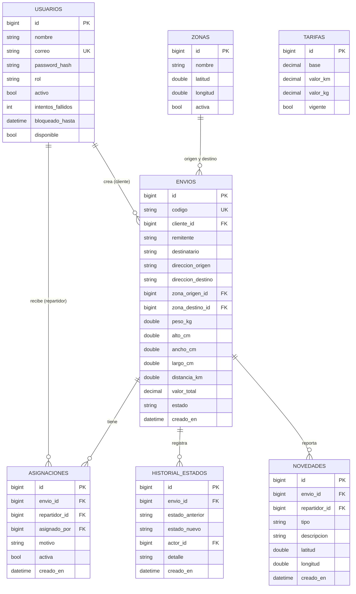

# UQDelivery – Guía del Caso de Uso 00 (Fundación técnica) · v3 (React)

> **Qué es:** el trabajo base que hace TODO el equipo en los días 1 y 2 del sprint, antes de que cada uno empiece su HU.
> **Para qué:** que la base de datos, los estados, la seguridad y las respuestas de la API sean iguales para todos, y así no haya choques después.
> **Stack:** Java + Spring Boot (backend) · React (frontend) · JUnit 5 (pruebas) · MySQL en Docker · Git.

---

## 1. Alcance: 1 sprint de 2 semanas, 6 personas, 6 HU

| HU | Nombre | Pts | Tipo |
|---|---|---|---|
| HU-01 | Registro e inicio de sesión | 5 | Obligatoria |
| HU-02 | Gestión de perfiles y roles | 5 | Obligatoria |
| HU-04 | Creación de solicitud de envío | 5 | Obligatoria |
| HU-05 | Cotización automática | 3 | Obligatoria |
| HU-06 | Asignación y reasignación de repartidores | 5 | Elegida |
| HU-10 | Reporte de novedades | 3 | Elegida |
| | **Total** | **26** | (velocidad del equipo: 24) |

**Por qué HU-06 y HU-10:** con ellas el sistema cuenta una historia completa. El cliente crea el envío, el admin lo asigna y el repartidor lo entrega o reporta un problema.

**Reparto: una HU por persona (6 personas)**

| Persona | HU que lidera | Trabajo del Caso 00 |
|---|---|---|
| Compañero 1| HU-01 | **Todo el Caso 00**: proyecto Spring, entidades, seguridad JWT, errores, `EstadoService`, base de React, Docker, Git |
| Compañero 2 | HU-04 | Acordar con HU-05 la firma de `CotizacionService`; revisar tus Pull Requests |
| Compañero 3 | HU-05 | `CotizacionService` y `haversine` |
| Compañero 4 | HU-02 | Revisar el contrato de API y las rutas por rol |
| Compañero 5 | HU-06 | Revisar `EstadoService` |
| Compañero 6 | HU-10 | Pruebas y cobertura (JaCoCo) |

Si el sprint se aprieta, lo primero que se recorta es HU-10 (3 pts).

---

## 2. Stack y versiones recomendadas

| Capa | Tecnología |
|---|---|
| Backend | Java 17 o 21, Spring Boot 3.x, Maven |
| Dependencias Spring | Web, Data JPA, Security, Validation, MySQL Driver, Lombok (opcional) |
| JWT | `jjwt` (io.jsonwebtoken) |
| Base de datos | MySQL 8 en contenedor Docker |
| Pruebas | JUnit 5 + Mockito + MockMvc; BD en memoria H2 para pruebas; JaCoCo para cobertura |
| Frontend | React 18+ con Vite (JavaScript o TypeScript), React Router, Axios, React Hook Form (opcional) |
| Despliegue | Contenedor Docker (Render / Railway) y front en Vercel o Netlify (`npm run build`) |

---

## 3. Arquitectura en capas (la explicación simple)

Una petición siempre recorre el mismo camino:

```
React    ──►  Controller  ──►  Service  ──►  Repository  ──►  MySQL
(front)       (recibe/responde)  (reglas)     (consulta BD)
                    ▲                              │
                    └──── DTO (lo que viaja) ◄── Entity (tabla)
```

| Capa | Qué hace | Qué NO hace | Ejemplo |
|---|---|---|---|
| **Controller** | Recibe la petición HTTP, valida el DTO y llama al service | No tiene reglas de negocio ni consultas | `EnvioController` |
| **Service** | Aquí viven las reglas (cotizar, cambiar estado, bloquear cuenta) | No sabe de HTTP | `EnvioService` |
| **Repository** | Habla con la BD (interfaz de Spring Data JPA) | No tiene reglas | `EnvioRepository` |
| **Entity (modelo)** | Clase Java con anotaciones JPA = una tabla | No tiene lógica pesada | `Envio` |
| **DTO** | Objeto que entra y sale por la API | No es una tabla | `CrearEnvioRequest`, `EnvioResponse` |

**Por qué existen los DTO:** nunca devolvemos la entidad `Usuario` tal cual, porque llevaría el `passwordHash`. Se devuelve un `UsuarioResponse` con los campos seguros.

### Estructura de paquetes

```
backend/src/main/java/co/edu/uq/uqdelivery/
├── UqdeliveryApplication.java
├── config/            # SecurityConfig, CorsConfig, DataSeeder
├── controller/        # AuthController, UsuarioController, EnvioController, ...
├── service/           # AuthService, UsuarioService, EnvioService, CotizacionService, EstadoService, AsignacionService, NovedadService
├── repository/        # UsuarioRepository, EnvioRepository, ZonaRepository, ...
├── model/             # entidades JPA + enums (Usuario, Envio, Zona, Tarifa, Asignacion, HistorialEstado, Novedad, Rol, EstadoEnvio)
├── dto/               # request/ y response/
├── security/          # JwtService, JwtAuthFilter
└── exception/         # AppException, GlobalExceptionHandler
backend/src/test/java/...   # pruebas espejo de los paquetes
```

---

## 4. Git (simple y suficiente)

- `main`: siempre estable, y es lo que se despliega.
- `feature/HU-04-crear-envio`: una rama por HU, que sale de `main`.
- Se junta a `main` mediante **Pull Request** con al menos 1 revisión de otra persona.

```bash
git checkout main && git pull
git checkout -b feature/HU-04-crear-envio
# ... trabajar ...
git add . && git commit -m "feat(HU-04): crear envío con código de seguimiento"
git pull --rebase origin main        # antes de subir, para evitar conflictos
git push -u origin feature/HU-04-crear-envio
# abrir Pull Request en GitHub
```

Reglas: nadie hace push directo a `main`, y los commits llevan prefijo (`feat`, `fix`, `test`, `docs`). Una sola rama de larga vida (`main`) es suficiente para un sprint de 2 semanas.

---

## 5. Base de datos con JPA (MySQL en Docker)

### 5.1 `docker-compose.yml` (en la raíz del proyecto)

```yaml
services:
  mysql:
    image: mysql:8
    container_name: uqdelivery-db
    environment:
      MYSQL_DATABASE: uqdelivery
      MYSQL_USER: uq
      MYSQL_PASSWORD: uq123
      MYSQL_ROOT_PASSWORD: root123
    ports: ["3306:3306"]
    volumes: [mysql_data:/var/lib/mysql]
volumes:
  mysql_data:
```
Se levanta con `docker compose up -d`.

### 5.2 `application.yml`

```yaml
spring:
  datasource:
    url: jdbc:mysql://localhost:3306/uqdelivery
    username: uq
    password: uq123
  jpa:
    hibernate:
      ddl-auto: update      # JPA crea/ajusta las tablas desde las anotaciones
    properties.hibernate.dialect: org.hibernate.dialect.MySQLDialect
app:
  jwt:
    secret: ${JWT_SECRET:cambiar-este-secreto-de-al-menos-32-caracteres}
    expiration-minutes: 120
```

### 5.3 Modelo de datos (DER) para las 6 HU



**Decisiones para justificar en el documento del DER:**
- El rol es un `enum` guardado como texto en `usuarios.rol`. Con solo 3 roles fijos, una tabla aparte no aporta.
- El paquete (peso y dimensiones) va dentro de `envios`, porque es 1 a 1.
- La distancia no usa mapas: sale de `ZONAS` (lat/lng) con la fórmula de Haversine.
- `HISTORIAL_ESTADOS` guarda cada cambio de estado, quién lo hizo y cuándo, y también las reasignaciones.

### 5.4 Ejemplos de entidades (anotaciones JPA)

```java
public enum Rol { ADMIN, CLIENTE, REPARTIDOR }
public enum EstadoEnvio { REGISTRADO, ASIGNADO, EN_RUTA, CON_NOVEDAD, ENTREGADO }

@Entity @Table(name = "usuarios")
@Getter @Setter @NoArgsConstructor
public class Usuario {
    @Id @GeneratedValue(strategy = GenerationType.IDENTITY)
    private Long id;
    @Column(nullable = false) private String nombre;
    @Column(nullable = false, unique = true) private String correo;
    @Column(nullable = false) private String passwordHash;
    @Enumerated(EnumType.STRING) @Column(nullable = false) private Rol rol;
    private boolean activo = true;
    private int intentosFallidos = 0;
    private LocalDateTime bloqueadoHasta;
    private boolean disponible = true;      // solo aplica a repartidores
}

@Entity @Table(name = "envios")
@Getter @Setter @NoArgsConstructor
public class Envio {
    @Id @GeneratedValue(strategy = GenerationType.IDENTITY)
    private Long id;
    @Column(unique = true) private String codigo;            // UQD-000123
    @ManyToOne(fetch = FetchType.LAZY) @JoinColumn(name = "cliente_id", nullable = false)
    private Usuario cliente;
    @ManyToOne(fetch = FetchType.LAZY) @JoinColumn(name = "zona_origen_id")  private Zona zonaOrigen;
    @ManyToOne(fetch = FetchType.LAZY) @JoinColumn(name = "zona_destino_id") private Zona zonaDestino;
    private String remitente, destinatario, direccionOrigen, direccionDestino;
    private double pesoKg, altoCm, anchoCm, largoCm;
    private double distanciaKm;
    @Column(precision = 12, scale = 2) private BigDecimal valorTotal;
    @Enumerated(EnumType.STRING) @Column(nullable = false)
    private EstadoEnvio estado = EstadoEnvio.REGISTRADO;
    private LocalDateTime creadoEn = LocalDateTime.now();
}

public interface EnvioRepository extends JpaRepository<Envio, Long> {
    List<Envio> findByClienteIdOrderByCreadoEnDesc(Long clienteId);
    Optional<Envio> findByCodigo(String codigo);
}
```

**Código de seguimiento:** se genera después de guardar, con el id que asignó la BD. Así no hay códigos repetidos aunque dos personas creen un envío a la vez.
```java
Envio guardado = envioRepository.save(envio);
guardado.setCodigo(String.format("UQD-%06d", guardado.getId()));
```

---

## 6. Máquina de estados (lo más importante del Caso 00)

| Desde | Hacia | Quién | HU |
|---|---|---|---|
| (nuevo) | REGISTRADO | Cliente | HU-04 |
| REGISTRADO | ASIGNADO | Admin | HU-06 |
| ASIGNADO | ASIGNADO (reasignación, cambia el repartidor) | Admin | HU-06 |
| ASIGNADO | EN_RUTA | Repartidor ("Iniciar entrega") | Caso 00 |
| EN_RUTA | CON_NOVEDAD | Repartidor | HU-10 |
| CON_NOVEDAD | EN_RUTA | Repartidor ("Retomar") | Caso 00 |
| EN_RUTA / CON_NOVEDAD | ENTREGADO | Repartidor ("Marcar entregado") | Caso 00 |

> "Iniciar entrega" y "Marcar entregado" (sin foto ni firma) quedan en el Caso 00. Sin ellos, HU-10 no se puede probar porque nadie pone el envío "En ruta".

**Un solo servicio, usado por todos:**

```java
@Service @RequiredArgsConstructor
public class EstadoService {
    private static final Map<EstadoEnvio, Map<EstadoEnvio, Rol>> TRANSICIONES = Map.of(
        EstadoEnvio.REGISTRADO,  Map.of(EstadoEnvio.ASIGNADO, Rol.ADMIN),
        EstadoEnvio.ASIGNADO,    Map.of(EstadoEnvio.EN_RUTA, Rol.REPARTIDOR),
        EstadoEnvio.EN_RUTA,     Map.of(EstadoEnvio.CON_NOVEDAD, Rol.REPARTIDOR,
                                        EstadoEnvio.ENTREGADO,   Rol.REPARTIDOR),
        EstadoEnvio.CON_NOVEDAD, Map.of(EstadoEnvio.EN_RUTA,     Rol.REPARTIDOR,
                                        EstadoEnvio.ENTREGADO,   Rol.REPARTIDOR),
        EstadoEnvio.ENTREGADO,   Map.of());

    private final EnvioRepository envioRepository;
    private final HistorialEstadoRepository historialRepository;

    @Transactional
    public Envio cambiarEstado(Long envioId, EstadoEnvio nuevo, Usuario actor, String detalle) {
        Envio envio = envioRepository.findById(envioId)
            .orElseThrow(() -> new AppException("NO_ENCONTRADO", "Envío no encontrado", HttpStatus.NOT_FOUND));

        Rol rolRequerido = TRANSICIONES.get(envio.getEstado()).get(nuevo);
        if (rolRequerido == null)
            throw new AppException("TRANSICION_INVALIDA",
                "No se puede pasar de " + envio.getEstado() + " a " + nuevo, HttpStatus.CONFLICT);
        if (rolRequerido != actor.getRol())
            throw new AppException("PROHIBIDO", "Acceso no autorizado", HttpStatus.FORBIDDEN);

        EstadoEnvio anterior = envio.getEstado();
        envio.setEstado(nuevo);
        envioRepository.save(envio);
        historialRepository.save(new HistorialEstado(envio, anterior, nuevo, actor, detalle));
        return envio;
    }
}
```

**Regla del equipo:** nadie hace `envio.setEstado(...)` por su cuenta. Siempre se llama a `EstadoService.cambiarEstado()`. La reasignación (HU-06) deja el estado en ASIGNADO, pero escribe en el historial quién, cuándo y por qué.

---

## 7. Contrato de la API

Base: `/api/v1`. JSON siempre.

| Método | Ruta | Rol | HU |
|---|---|---|---|
| POST | `/auth/registro` | público | 01 |
| POST | `/auth/login` | público | 01 |
| GET · POST · PUT · PATCH | `/admin/usuarios` (crear, editar, desactivar, cambiar rol) | ADMIN | 02 |
| GET | `/zonas` | autenticado | 04/05 |
| POST | `/envios/cotizar` | CLIENTE | 05 |
| POST | `/envios` | CLIENTE | 04 |
| GET | `/envios` (los míos) · `/envios/{id}` | CLIENTE dueño | 04 |
| GET | `/admin/envios` · `/admin/repartidores` | ADMIN | 06 |
| POST | `/admin/envios/{id}/asignar` · `/reasignar` | ADMIN | 06 |
| GET | `/repartidor/entregas` | REPARTIDOR | 06 |
| PATCH | `/repartidor/envios/{id}/estado` | REPARTIDOR | Caso 00 |
| POST | `/repartidor/envios/{id}/novedades` | REPARTIDOR | 10 |

**Códigos HTTP:** 200 ok · 201 creado · 400 validación · 401 sin sesión · 403 sin permiso · 404 no existe · 409 conflicto (correo repetido, transición inválida) · 423 cuenta bloqueada · 422 destino fuera de cobertura.

**Formato de error único** (lo produce `GlobalExceptionHandler`):

```json
{ "codigo": "VALIDACION", "mensaje": "Datos inválidos", "campos": { "pesoKg": "Debe ser mayor a 0" } }
```

```java
public class AppException extends RuntimeException {
    private final String codigo; private final HttpStatus estado;
    public AppException(String codigo, String mensaje, HttpStatus estado) { super(mensaje); this.codigo = codigo; this.estado = estado; }
    // getters
}

public record ErrorResponse(String codigo, String mensaje, Map<String, String> campos) {}

@RestControllerAdvice
public class GlobalExceptionHandler {
    @ExceptionHandler(AppException.class)
    ResponseEntity<ErrorResponse> app(AppException e) {
        return ResponseEntity.status(e.getEstado()).body(new ErrorResponse(e.getCodigo(), e.getMessage(), null));
    }
    @ExceptionHandler(MethodArgumentNotValidException.class)
    ResponseEntity<ErrorResponse> validacion(MethodArgumentNotValidException e) {
        Map<String, String> campos = new HashMap<>();
        e.getBindingResult().getFieldErrors().forEach(f -> campos.put(f.getField(), f.getDefaultMessage()));
        return ResponseEntity.badRequest().body(new ErrorResponse("VALIDACION", "Datos inválidos", campos));
    }
}
```

---

## 8. Seguridad (Spring Security + JWT)

El esqueleto lo deja A en el Caso 00. HU-01 completa el detalle.

- **Token JWT** con el id y el rol del usuario, y expiración de 2 horas.
- **Contraseñas** con `BCryptPasswordEncoder`. Mínimo 8 caracteres con mayúscula, número y símbolo.
- **Bloqueo (HU-01):** 5 intentos fallidos → `bloqueadoHasta = ahora + 15 min` y respuesta 423 "Cuenta bloqueada temporalmente".
- **Roles en los endpoints:**

```java
@Configuration @EnableMethodSecurity
public class SecurityConfig {
    @Bean SecurityFilterChain chain(HttpSecurity http, JwtAuthFilter jwtFilter) throws Exception {
        return http
            .csrf(c -> c.disable())                                   // API sin cookies, usa JWT
            .sessionManagement(s -> s.sessionCreationPolicy(SessionCreationPolicy.STATELESS))
            .authorizeHttpRequests(a -> a
                .requestMatchers("/api/v1/auth/**").permitAll()
                .requestMatchers("/api/v1/admin/**").hasRole("ADMIN")
                .requestMatchers("/api/v1/repartidor/**").hasRole("REPARTIDOR")
                .anyRequest().authenticated())
            .addFilterBefore(jwtFilter, UsernamePasswordAuthenticationFilter.class)
            .build();
    }
    @Bean PasswordEncoder passwordEncoder() { return new BCryptPasswordEncoder(); }
}
```
Un cliente que llame a `/api/v1/admin/usuarios` recibe 403 (HU-02). Falta además cambiar `AccessDeniedHandler` para que el cuerpo sea el formato de error común.

- **Pertenencia del recurso:** además del rol, el service verifica que el envío sea del cliente (`envio.getCliente().getId().equals(actor.getId())`) o que esté asignado al repartidor. Si no, responde 403/404.

| Amenaza | Qué hacemos |
|---|---|
| **Inyección SQL** | Solo Spring Data JPA o `@Query` con parámetros nombrados. Prohibido concatenar strings en consultas |
| **XSS** | Rechazar HTML/script en textos libres con un validador propio, y React escapa por defecto (nunca usar `dangerouslySetInnerHTML` con datos del usuario) |
| **Validación doble** | Bean Validation en el DTO (backend) y validaciones en el formulario (React) |
| **Datos sensibles** | El `passwordHash` nunca sale en un DTO. El secreto JWT va en variable de entorno |
| **CORS** | Permitir solo el origen del front |

Validación en el DTO (con regla anti-HTML):

```java
@Target(FIELD) @Retention(RUNTIME) @Constraint(validatedBy = SinHtmlValidator.class)
public @interface SinHtml { String message() default "Contiene caracteres no permitidos"; Class<?>[] groups() default {}; Class<? extends Payload>[] payload() default {}; }

public class SinHtmlValidator implements ConstraintValidator<SinHtml, String> {
    private static final Pattern PELIGROSO = Pattern.compile("<[^>]*>|javascript:|on\\w+\\s*=", Pattern.CASE_INSENSITIVE);
    public boolean isValid(String v, ConstraintValidatorContext c) { return v == null || !PELIGROSO.matcher(v).find(); }
}

public record CrearEnvioRequest(
    @NotBlank @SinHtml String remitente,
    @NotBlank @SinHtml String destinatario,
    @NotBlank @SinHtml String direccionOrigen,
    @NotBlank @SinHtml String direccionDestino,
    @NotNull Long zonaOrigenId,
    @NotNull Long zonaDestinoId,
    @Positive double pesoKg,
    @Positive double altoCm, @Positive double anchoCm, @Positive double largoCm) {}
```

---

## 9. Cotización sin mapas (HU-05)

```
distancia_km = haversine(zonaOrigen, zonaDestino)
valor        = tarifa.base + distancia_km * tarifa.valorKm + pesoKg * tarifa.valorKg
```

- Se usa la tarifa con `vigente = true`, y se muestra el desglose (base, km, kg, total).
- Si la zona de destino no existe o está inactiva → 422 "Destino fuera de cobertura".
- **HU-04 usa este mismo `CotizacionService`** al crear el envío, para que el valor guardado coincida con el cotizado.

```java
public static double haversine(double lat1, double lon1, double lat2, double lon2) {
    double R = 6371, dLat = Math.toRadians(lat2 - lat1), dLon = Math.toRadians(lon2 - lon1);
    double a = Math.pow(Math.sin(dLat / 2), 2)
             + Math.cos(Math.toRadians(lat1)) * Math.cos(Math.toRadians(lat2)) * Math.pow(Math.sin(dLon / 2), 2);
    return Math.round(2 * R * Math.asin(Math.sqrt(a)) * 100.0) / 100.0;
}
```

---

## 10. Frontend React (base del Caso 00)

React usa **JSX**: HTML escrito dentro de JavaScript. Cada pantalla es un componente (`Login.jsx`) y el CSS va en un archivo aparte (`Login.css`) o en uno global (`index.css`).

Crear el proyecto: `npm create vite@latest frontend -- --template react` (o `react-ts` si usan TypeScript), luego `npm i react-router-dom axios`.

```
frontend/src/
├── api/
│   └── client.js           # instancia de Axios con la URL del backend y el token
├── auth/
│   ├── AuthContext.jsx     # guarda usuario/token y expone login() y logout()
│   └── ProtectedRoute.jsx  # protege rutas por sesión y por rol
├── components/             # reutilizables: Input (con error), Button, Table, Toast, Loading
├── layouts/                # AdminLayout, ClienteLayout, RepartidorLayout (menú por rol)
├── pages/
│   ├── auth/               # HU-01: Login.jsx, Registro.jsx
│   ├── admin/              # HU-02 (usuarios) y HU-06 (asignar)
│   ├── cliente/            # HU-04 y HU-05
│   ├── repartidor/         # HU-06 (mis entregas) y HU-10
│   └── NoAutorizado.jsx
├── App.jsx                 # rutas
├── main.jsx
└── index.css               # colores y tipografía comunes del equipo
.env                        # VITE_API_URL=http://localhost:8080/api/v1
```

**Cliente HTTP único (agrega el token y maneja 401):**
```js
// api/client.js
import axios from 'axios';
const api = axios.create({ baseURL: import.meta.env.VITE_API_URL });

api.interceptors.request.use((config) => {
  const token = localStorage.getItem('token');
  if (token) config.headers.Authorization = `Bearer ${token}`;
  return config;
});
api.interceptors.response.use(
  (res) => res,
  (err) => {
    if (err.response?.status === 401) { localStorage.removeItem('token'); window.location.href = '/login'; }
    return Promise.reject(err);
  });
export default api;
```

**Ruta protegida por rol:**
```jsx
// auth/ProtectedRoute.jsx
import { Navigate } from 'react-router-dom';
import { useAuth } from './AuthContext';

export default function ProtectedRoute({ roles, children }) {
  const { user } = useAuth();
  if (!user) return <Navigate to="/login" replace />;
  if (roles && !roles.includes(user.rol)) return <Navigate to="/no-autorizado" replace />;
  return children;
}

// App.jsx
<Route path="/admin/*" element={
  <ProtectedRoute roles={['ADMIN']}><AdminLayout /></ProtectedRoute>} />
```

**Reglas del front:**
- Los formularios validan con las mismas reglas que el backend (peso > 0, campos obligatorios, sin HTML) y muestran los errores por campo usando `campos` del formato de error de la API.
- Si el rol no corresponde, se muestra "Acceso no autorizado".
- La URL del backend va solo en `.env` (`VITE_API_URL`), distinta en local y en la nube.
- Cada HU crea sus páginas dentro de `pages/` y sus llamadas a la API en un archivo propio (por ejemplo `api/envios.js`), para evitar choques en Git.

---

## 11. Pruebas con JUnit 5 (meta 60-70 % en backend)

| Qué | Cómo |
|---|---|
| Services (reglas de negocio) | JUnit 5 + Mockito, con los repositorios simulados (`@Mock`) |
| Controllers | `@WebMvcTest` + `MockMvc` (códigos HTTP y formato de error) |
| Repositories (opcional) | `@DataJpaTest` con H2 |
| Cobertura | Plugin **JaCoCo** en el `pom.xml`: `mvn clean test` genera `target/site/jacoco/index.html` |

Ejemplo (prueba del Caso 00):

```java
@ExtendWith(MockitoExtension.class)
class EstadoServiceTest {
    @Mock EnvioRepository envioRepository;
    @Mock HistorialEstadoRepository historialRepository;
    @InjectMocks EstadoService estadoService;

    @Test
    void repartidorPuedeIniciarEntregaDeUnEnvioAsignado() {
        Envio envio = new Envio(); envio.setEstado(EstadoEnvio.ASIGNADO);
        Usuario repartidor = new Usuario(); repartidor.setRol(Rol.REPARTIDOR);
        when(envioRepository.findById(1L)).thenReturn(Optional.of(envio));

        Envio resultado = estadoService.cambiarEstado(1L, EstadoEnvio.EN_RUTA, repartidor, "");

        assertEquals(EstadoEnvio.EN_RUTA, resultado.getEstado());
        verify(historialRepository).save(any());
    }

    @Test
    void noSePuedePasarDeRegistradoAEntregado() {
        Envio envio = new Envio(); envio.setEstado(EstadoEnvio.REGISTRADO);
        Usuario repartidor = new Usuario(); repartidor.setRol(Rol.REPARTIDOR);
        when(envioRepository.findById(1L)).thenReturn(Optional.of(envio));

        AppException e = assertThrows(AppException.class,
            () -> estadoService.cambiarEstado(1L, EstadoEnvio.ENTREGADO, repartidor, ""));
        assertEquals("TRANSICION_INVALIDA", e.getCodigo());
    }
}
```

**Mínimo por HU:** 1 prueba del camino feliz y 1 por cada criterio de error. Pruebas obligatorias del Caso 00: `EstadoService` (válida, inválida, rol incorrecto), `haversine`, `SinHtmlValidator` y el bloqueo de cuenta.

---

## 12. Datos semilla (`DataSeeder`)

Para que todos trabajen desde el día 3 sin esperar a las HU de los demás:

```java
@Component @RequiredArgsConstructor
class DataSeeder implements CommandLineRunner {
    public void run(String... args) {
        if (usuarioRepository.count() > 0) return;
        // 1 ADMIN, 2 CLIENTE, 2 REPARTIDOR (contraseña de prueba documentada en el README)
        // 5-6 zonas con latitud/longitud (1 inactiva para probar "fuera de cobertura")
        // 1 tarifa vigente
        // ~10 envíos en distintos estados, con asignaciones e historial
    }
}
```

---

## 13. Despliegue (se prueba a mitad del sprint, no al final)

1. Backend: `Dockerfile` (imagen con Java 17 y el `.jar`) → Render o Railway, con una MySQL gestionada y las variables de entorno (`SPRING_DATASOURCE_URL`, `JWT_SECRET`).
2. Frontend: `npm run build` → Vercel o Netlify, con `VITE_API_URL` apuntando al backend en la nube.
3. CORS del backend permite el dominio del front.
4. Prueben el despliegue el **día 5** con el login funcionando. Dejarlo para el último día es el error más común.

---

## 14. Backlog y documentación

- **Backlog** en Trello, Jira o GitHub Projects con las 6 HU, sus puntos, sus criterios de validación y columnas *Por hacer → En progreso → En revisión → Hecho*.
- **README** con: cómo levantar todo (`docker compose up -d`, `mvn spring-boot:run`, `npm run dev`), usuarios de prueba y variables de entorno.
- **`docs/`** con el DER y esta guía.

---

## 15. Checklist de cierre del Caso 00 (fin del día 2)

- [ ] Repo creado y `main` protegido, con la regla de Pull Request.
- [ ] `docker compose up -d` levanta MySQL, y el backend arranca y crea las tablas.
- [ ] Todas las entidades y enums del DER existen y son revisadas por el equipo.
- [ ] `DataSeeder` carga usuarios (uno por rol), zonas, tarifa y envíos de ejemplo.
- [ ] Se puede iniciar sesión con cada rol (aunque sea el esqueleto) y los `/admin/**` devuelven 403 a otros roles.
- [ ] `GlobalExceptionHandler` y el formato de error único funcionan.
- [ ] `EstadoService.cambiarEstado()` implementado y con pruebas (válida, inválida, rol incorrecto).
- [ ] React base: layouts por rol, `ProtectedRoute`, cliente Axios con interceptor y componentes comunes.
- [ ] JaCoCo configurado y `mvn test` en verde.
- [ ] Contrato de API (sección 7) aceptado por todos.
- [ ] Backlog cargado con las 6 HU.

## 16. Definition of Done (por HU)

1. Cumple **todos** los criterios de validación de la HU (el camino feliz y el de error).
2. Valida en el front y en el back, sin HTML/script y con consultas parametrizadas.
3. Respeta las capas (Controller → Service → Repository) y el formato de error común.
4. Tiene pruebas JUnit y la cobertura global no baja de la meta.
5. Pasó el Pull Request con al menos 1 revisión.
6. Funciona en el ambiente desplegado.
7. La tarjeta del backlog está en "Hecho".

## 17. Cronograma del sprint (10 días hábiles)

| Días | Qué | Quién |
|---|---|---|
| **1** | Reunión de 1-2 h para acordar DER y contrato de API. Repo, Docker y proyectos base (Spring y React) | Todos / Tú |
| **1-2** | Entidades y repositorios, seeds, errores y validaciones, seguridad y JWT, `EstadoService` y base de React. Los demás revisan los Pull Requests y acuerdan la firma de `CotizacionService` (HU-04 y HU-05) | Tú + revisión del equipo |
| **2** | Revisión cruzada y checklist de la sección 15 | Todos |
| **3-7** | Cada quien su HU en su rama, con Pull Requests diarios pequeños | Todos |
| **5** | Primer despliegue en la nube con login funcionando | Tú |
| **8-9** | Integración, pruebas hasta el 60-70 %, revisión de seguridad | Todos |
| **10** | Despliegue final, ensayo de la demo y cierre del sprint | Todos |
